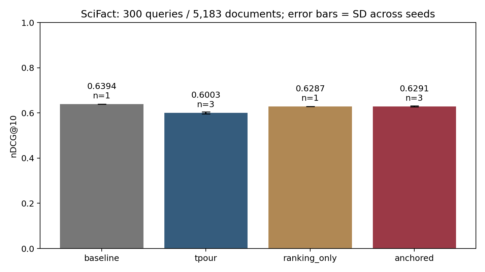
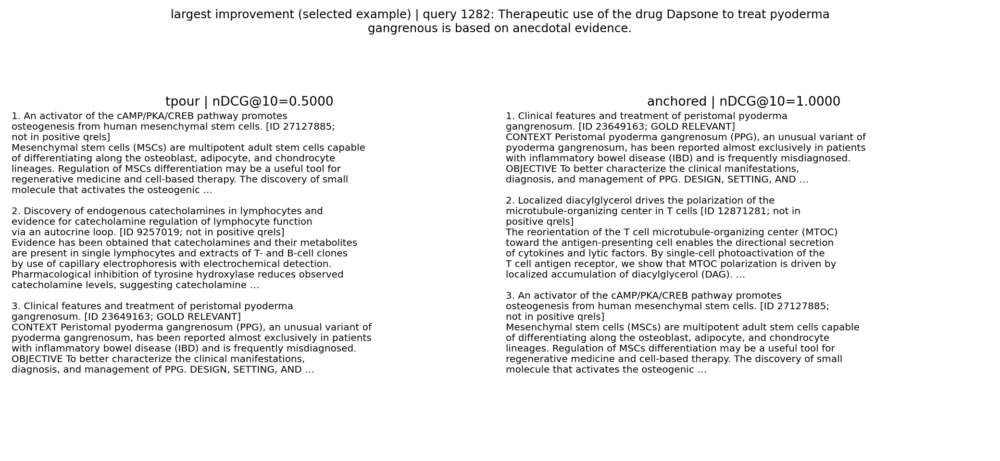

# Biến thể retention cho TPOUR — kết quả thực trên Kaggle

[Notebook train và ablation](https://www.kaggle.com/code/vananh1911/tpour-retention-improvement-demo), phiên bản 1, code huấn luyện `219a21a`. [Thiết kế cố định trước khi chạy](../../ANCHORED_METHOD.md). Đây là cải tiến objective của bản thực hành; knowledge distillation là kỹ thuật đã có, chưa có tuyên bố tính mới qua peer review.

Giữ CE+TRPO, momentum reference và queue; thêm teacher Contriever cố định. Loss bổ sung: `10 × (ranking KL + relative embedding MSE)`. Temperature KL=0,1; hệ số MSE=1. Teacher chỉ dùng khi train; inference chỉ dùng student, không trộn điểm baseline.

## Kết quả chính

Wikipedia thật: 2.543 mẫu train, 449 mẫu preference giữ riêng. SciFact: đủ 300 test queries / 5.183 tài liệu. Seed 42/43/44, mỗi run 1.000 lần thử bước; 995 cập nhật thực ở tất cả nhánh. Cùng batch4, queue4096, max length256, lr1e-6 và chế độ đánh giá. Không chọn gamma hoặc checkpoint tốt nhất theo SciFact test.

| Nhánh | nDCG@10 mean | Sample SD | Số seed |
|---|---:|---:|---:|
| Contriever gốc | 0,63935 | — | Mô hình cố định |
| TRPO đối chứng | 0,60035 | 0,00432 | 3 |
| Chỉ thêm ranking KL | 0,62870 | — | 1 |
| Thêm KL + relative MSE | 0,62907 | 0,00204 | 3 |

Chênh lệch mean retention − TRPO: **+0,02872 nDCG@10** (2,872 điểm trên thang 100, tương đối khoảng 4,78%). Cả ba seed cải thiện; CI bootstrap ghép cặp theo query, 5.000 lần:

| Seed | TRPO | Retention | Delta | CI95% delta |
|---|---:|---:|---:|---|
| 42 | 0,59572 | 0,63082 | +0,03510 | [+0,02181; +0,04887] |
| 43 | 0,60429 | 0,62956 | +0,02527 | [+0,01298; +0,03779] |
| 44 | 0,60104 | 0,62684 | +0,02580 | [+0,01336; +0,03881] |

Các CI này mô tả bất định theo query của từng lần chạy; không phải CI tổng quát cho mọi seed/domain.

## Giới hạn và đánh đổi phải báo cáo

- Retention vẫn thấp hơn Contriever gốc về mean nDCG@10 **0,01028**. CI delta với baseline chứa 0 ở seed42/43, âm ở seed44. Chưa chứng minh vượt baseline.
- Accuracy trên mined preference giữ riêng **giảm từ 0,44915 xuống 0,42910** (mean ba seed), thấp hơn 0,5. Đây là dấu hiệu đánh đổi; không thể kết luận cải thiện temporal alignment. Nhãn mined chưa phải temporal QA gold.
- Phần MSE so với chỉ KL ở seed42 tăng 0,00212 nhưng CI [-0,00764; +0,01211] chứa 0. Chưa chứng minh MSE có lợi riêng về nDCG; chưa thử ablation nhiều seed.
- Top-10 overlap với baseline tăng từ khoảng 0,7173 (TRPO) lên 0,8884 (retention), phù hợp mục tiêu giữ xếp hạng teacher. Agreement không đồng nghĩa accuracy hoặc học đúng thời gian.
- Thời gian train trung bình tăng từ khoảng 332,2 lên 385,3 giây; peak allocated tăng từ khoảng 2,51 lên 2,92 GiB. Đây là chi phí hàm train, chưa gồm queue warmup/model loading/evaluate; không phải tổng VRAM thiết bị.
- Mẫu nhỏ, chia theo exact text; chưa loại mọi trùng article/excerpt. SciFact là general retrieval. Chưa tái lập temporal QA, nội suy time embedding và toàn bộ cấu hình của bài báo.
- Kết quả SciFact trước đã được xem để nhận diện vấn đề rồi mới thiết kế retention. Cố định kế hoạch lần chạy mới không xóa được thiên lệch thiết kế do đã biết benchmark; cần thêm benchmark chưa dùng khi thiết kế trước khi đưa ra kết luận nghiên cứu rộng hơn.

Kết luận phù hợp: **thêm fixed-teacher retention giúp giảm suy giảm truy xuất tổng quát so với TRPO đối chứng trong thử nghiệm này; chưa phải cải thiện toàn diện cho bài toán thời gian**.

## Demo và kiểm chứng

```powershell
python demo_retention.py --root results/anchored_kaggle --query-id 1
python demo_retention.py --root results/anchored_kaggle --query-id 1282
python demo_retention.py --root results/anchored_kaggle --query-id 314
python tools/demo_anchored_results.py --root results/anchored_kaggle --data data/scifact --output results/anchored_kaggle/demo
python verify_anchor_results.py --root results/anchored_kaggle
```

Đây là replay rankings từ run thật, ghi rõ chế độ. Query1 chọn cố định trước; query1282 chọn vì cải thiện nhiều nhất, query314 chọn vì giảm nhiều nhất ở seed42. Hai ví dụ sau chỉ minh họa, không đại diện cho toàn bộ test. Nhãn `not in positive qrels` không khẳng định tài liệu đã được người gán nhãn là âm.

Demo **inference thực** từ checkpoint: [notebook riêng](https://www.kaggle.com/code/vananh1911/tpour-live-checkpoint-verification), [mã chạy query mới](../../live_retrieval_demo.py). Lần đầu tạo index, các query sau dùng cache có kiểm tra hash model/corpus. Query mới không có qrels nên không báo accuracy.

[Phụ lục Word](../../reports/anchored_improvement/Bao_cao_cai_tien_TPOUR_retention.docx), [8 slide bổ sung](../../reports/anchored_improvement/Slide_cai_tien_TPOUR_retention.pptx). Không sửa đè báo cáo/slide cũ. Tất cả biểu đồ/ảnh demo được tạo bằng code, không dùng ảnh AI hoặc web demo giả.

`verification.json` ghi việc tính lại mọi metric từ top-100 rankings và qrels, so config/hash và tính lại paired bootstrap. Checkpoint lớn giữ ở Kaggle Output, không đưa lên GitHub. Kết quả train là bản gọn nhóm triển khai, không phải chạy nguyên mã distributed của tác giả.




