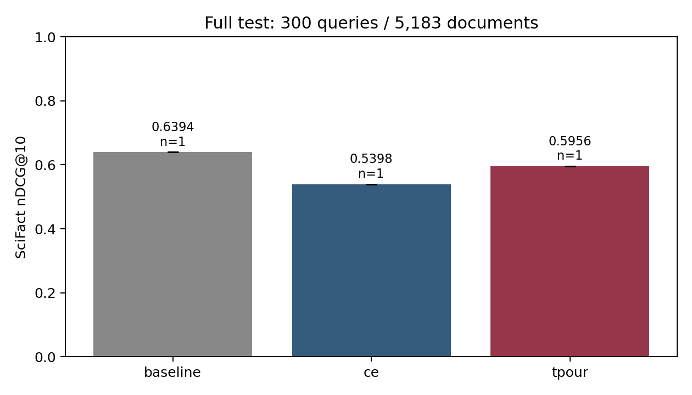
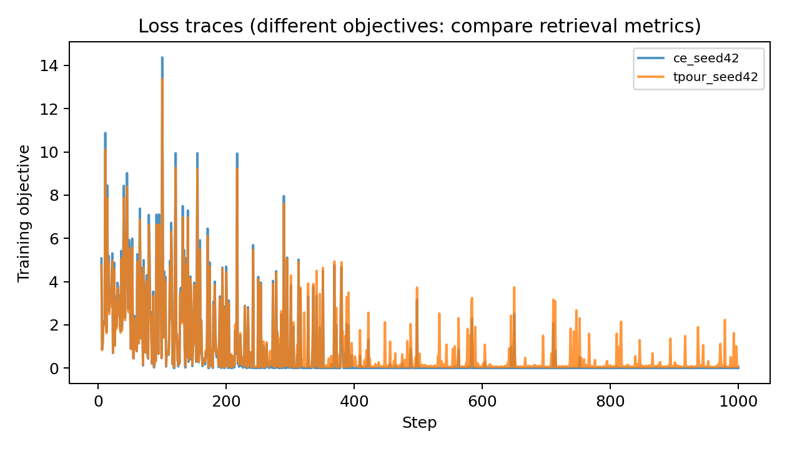

# Kết quả Kaggle thực — seed 42

[Notebook, phiên bản 1](https://www.kaggle.com/code/vananh1911/tpour-trpo-real-data-scifact). Code `cf41598`; GPU Tesla T4, Python 3.13.15, PyTorch 2.11.0+cu128, Transformers 4.57.6. Hai nhánh dùng cùng cấu hình, 2.543 mẫu Wikipedia thật để train và 449 mẫu preference giữ riêng. SciFact test gồm đủ 300 truy vấn, 5.183 tài liệu.

| Nhánh | nDCG@5 | nDCG@10 | Recall@10 | MRR@10 | Accuracy preference giữ riêng |
|---|---:|---:|---:|---:|---:|
| Contriever gốc | 0,6168 | 0,6394 | 0,7878 | 0,5981 | 0,4388 |
| Chỉ CE | 0,5151 | 0,5398 | 0,6787 | 0,5030 | 0,3987 |
| CE + TRPO | 0,5706 | 0,5956 | 0,7379 | 0,5567 | 0,4477 |

CE+TRPO hơn CE **0,05584 nDCG@10** (5,584 điểm trên thang 100); CI bootstrap ghép cặp 95% [0,03881; 0,07408]. Có 73 truy vấn tốt hơn, 19 kém hơn và 208 không đổi. Tuy nhiên CE+TRPO vẫn kém Contriever gốc **0,04376**; CI [-0,06068; -0,02672]. CE giảm 0,09960 so với mô hình gốc.

Kết luận: trong cấu hình/seed này, thêm TRPO hạn chế mức giảm so với chỉ CE; chưa cải thiện mô hình gốc. Chưa tái lập đầy đủ bài báo. Chỉ một seed nên chưa đo được độ ổn định giữa các lần train. SciFact không phải benchmark kiểm chứng thời gian; accuracy trên mined preferences không phải accuracy temporal QA có nhãn chuẩn và vẫn dưới 0,5 cho mọi nhánh.

Mỗi nhánh có 1.000 lần thử bước train. AMP bỏ qua 6 bước CE, 5 bước TRPO vì gradient không hữu hạn; số cập nhật thực là 994 và 995, cần ghi rõ khi so sánh. Thời gian hàm train: CE 329,1 giây, TRPO 333,8 giây; không tính tải model, encode và evaluate. Peak GPU allocated khoảng 2,51 GiB, không phải tổng bộ nhớ thiết bị.

Tất cả metric đã tính lại từ `run.json` và qrels SciFact gốc, khớp số liệu đã lưu. Hash, môi trường, cấu hình, log và kết quả từng query được lưu tại các thư mục nhánh. `verification.json` ghi nguồn và kiểm tra. Checkpoint lớn giữ ở Kaggle Output, không đưa lên GitHub.

Các bước tiếp theo hợp lý: chạy thêm seed theo cấu hình đã định, kiểm tra mined labels và augmentation, thêm benchmark thời gian có gold labels; không chọn cấu hình tốt nhất dựa trên SciFact test rồi dùng lại bộ test đó để tuyên bố cải thiện.
