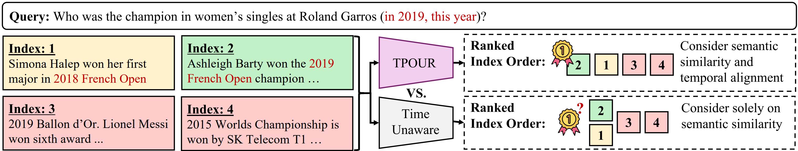
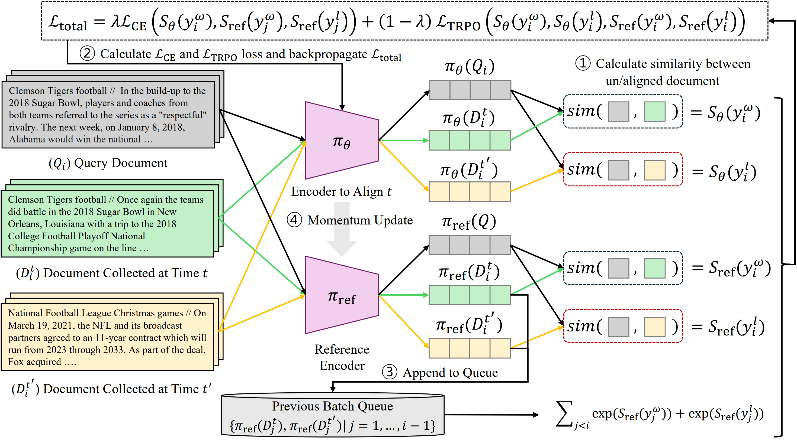

# Temporal Preference Optimization for Unsupervised Retrieval (TPOUR)

> **HyunJin Kim, Jaejun Shim, Young Jin Kim, JinYeong Bak**
> *ICML 2026*

---

## Overview

**TPOUR (Temporal Preference Optimization for Unsupervised Retrieval)** is a framework for learning **temporally-aware dense retrievers** without requiring explicit timestamp supervision solely based on corpus-level temporal signal (i.e., data collected at a specific time).

Traditional unsupervised retrievers (e.g., contrastive learning–based models) focus purely on **semantic similarity**, often retrieving documents that are **temporally misaligned** with the query. TPOUR addresses this limitation by introducing **temporal preference learning** into the retrieval objective.

---

## Motivation

* Queries often contain **explicit** (e.g., "in 2019") or **implicit** (e.g., "this year") temporal intent
* Standard retrievers ignore this signal → **temporal misalignment**
* Supervised temporal retrieval requires labeled timestamps → **not scalable**



Figure: Comparison between TPOUR aligned at 2019 and a time-unaware retriever for queries with explicit (e.g., in 2019) or implicit (e.g., this year) temporal information. **Left**: A mixed-timestamp document collection containing (i) semantically and temporally aligned documents (green), (ii) semantically relevant but temporally misaligned documents (yellow), and (iii) irrelevant documents (red). **Right**: Ranked retrieval results. The time-unaware retriever, trained solely for semantic similarity, struggles to rank the temporally aligned document (green) over the misaligned (yellow). In contrast, the TPOUR-trained retriever prioritizes the temporally aligned document.

---

## Method

### Temporal Retrieval Preference Optimization (TRPO)

TPOUR integrates **contrastive learning** with a **preference optimization objective**:

* **Contrastive loss** → semantic similarity
* **TRPO loss** → temporal alignment based on preference learning

The model is trained to:

* Prefer **aligned document** $D^t$
* Over **misaligned document** $D^{t'}$

---

## Model Architecture



Figure: Overview of TPOUR. Given a query $Q_i$ and two documents $D_i^t$ (temporally aligned) and $D_i^{t'}$ (temporally misaligned), each input is encoded using both the main encoder $\pi_\theta$ and the reference encoder $\pi_{\text{ref}}$. (1) Similarity scores are computed between the query and each document using $\pi_\theta$. (2) A contrastive loss $L_{\text{CE}}$, which calculate semantic similarity between $Q_i$ and $D_i^t$, and a TRPO loss $L_{\text{TPRO}}$ for preferring temporally aligned documents are calculated to get combined loss $L_{\text{total}}$. (3) The reference embeddings $\pi_{\text{ref}}(D_i^t)$ and $\pi_{\text{ref}}(D_i^{t'})$ are added to a queue as negatives for future batches. (4) The encoder $\pi_\theta$ is updated via $L_{\text{total}}$, and $\pi_{\text{ref}}$ is updated via momentum from $\pi_\theta$.

### Key Components

* **Encoder** $\pi_\theta$: learns joint semantic + temporal representations
* **Reference encoder** $\pi_{\text{ref}}$: momentum-updated (MoCo-style)
* **Preference pairs**: constructed from documents across time periods
* **Loss function**:

  * $L_{CE} = -\log \frac{e^{S_\theta(y_i^w)}}{e^{S_\theta(y_i^w)} + \sum_{j<i} (e^{S_{\mathrm{ref}}(y_j^w)} + e^{S_{\mathrm{ref}}(y_j^l)})}$: contrastive learning
  * $L_{\mathrm{TRPO}} = -\log \sigma\big(\beta [S_\theta(y_i^w) - S_\theta(y_i^l) - (S_{\mathrm{ref}}(y_i^w) - S_{\mathrm{ref}}(y_i^l))]\big)$: temporal preference alignment
  * $L_{total} = \lambda L_{CE} + (1 - \lambda)L_{TRPO}$

---

## Continuous Temporal Generalization

TPOUR introduces **time vector interpolation** (1) to enable smooth adaptation to **intermediate time periods** and (2) without training:

* Extract temporal shift:
  $\tau_t = \theta_t - \theta_{\text{base}}$

* Interpolate between time periods:
  $\theta_{mid} = \theta_{\text{base}} + (1-\alpha)\tau_{t_1} + \alpha\tau_{t_2}$

---

## Installation & Usage

1. Install dependencies
```
conda env create --name tpour --file environment.yml
```

2. Activate the environment
```
conda activate tpour
```

3. Run finetuning via `finetune.sh` script
```
sh finetune.sh
```

## Data Preprocessing

### 1. Install and Run the Wikiextractor to Extract Wikipedia Dump File
### Usage
```
python -m wikiextractor.WikiExtractor <Wikipedia dump file> [--templates <extracted template file>]

python -m wikiextractor.WikiExtractor -o ./20181220_json --json enwiki-20181220-pages-articles-multistream.xml.bz2
```

### 2. Preprocess Extracted Documents (Clensing)
```
python build_preprocessed.py --num-workers 10 ./20181220_json_timestamp ./20181220_json_timestamp_preprocessed.json
```

### 3. Split-paragraph
```
python split_paragraph.py --input_path 20181220_json_timestamp_preprocessed_13717022.json --output_path 20181220_json_timestamp_splitted_13717022.json
```

### 4. Split into intersection/unique/combined dataset
```
python preprocessing/compare_documents_various.py \
  --input_path 20171220_preprocessed.json 20181220_preprocessed.json 20211220_preprocessed.json 20231220_preprocessed.json \
  --block_size 100 \
  --output_path ./preprocessing/data/
```

### 5. Create document embeddings & indexing
```
for i in 2018 2019; do
    d=preprocessing/${i}_filtered
    CUDA_VISIBLE_DEVICES=0 python preprocessing/contriever_embedding_and_indexing.py \
        --ctx_encoder_model_name facebook/contriever \
        --json_path ${d}.json \
        --output_dir ${d} \
        --year ${i}
done
```

### 6. Gather positive document pair for unsupervised TPOUR training
```
for type in combined; do
    for year_q in 20231220 20211220 20181220; do # if two years
        for year_d in 20231220 20211220 20181220; do
            path=preprocessing/data
            CUDA_VISIBLE_DEVICES=0 python preprocessing/contriever_mine_pos_neg_ctx.py \
                --input_query ${path}/${year_q}_${type} \
                --database_path ${path}/${year_d}_${type} \
                --index_path ${path}/${year_d}_${type}/gpu_indexivfpq.faiss \
                --n_docs 5 \
                --output_positive_path ${path}/q_${year_q}_d_${year_d}_${type}_positive_ctx.json \
                --output_negative_path ${path}/q_${year_q}_d_${year_d}_${type}_negative_ctx.json \
                --save_or_load_index
        done
    done
done
```

### 7. Finally, build TPOUR finetuning data
```
for year_q in 20231220; do
    python preprocessing/stream_create_finetuning_data.py \
        --input_path ./preprocessing/data/q_${year_q}_d_20181220_combined_positive_ctx.json \
        ./preprocessing/data/q_${year_q}_d_20211220_combined_positive_ctx.json \
        ./preprocessing/data/q_${year_q}_d_20231220_combined_positive_ctx.json \
        --output ./preprocessing/data/q_${year_q}_finetuning_data.jsonl
done
```

## Note
- While the current repo is already designed to train on a large dataset, due to limiited size for upload, we provide a small dataset (2018_sample_train_trimmed.jsonl) for testing and debugging.
- For the wikipedia dump, we recommend you to find relevant dump data in (https://dumps.wikimedia.org/)
- Please refer to './src/moco.py' for the implementation of TPOUR (it's implemented in TPOUR class).
- I need time to re-run & verify all process are correct, if you have any trouble, just let me know (email: khyunjin1993@gmail.com).